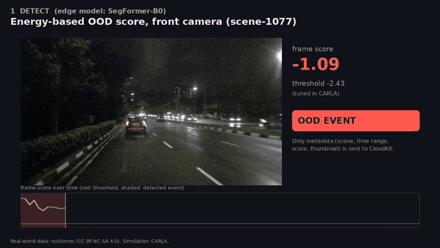
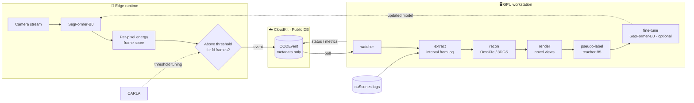
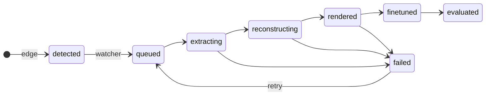
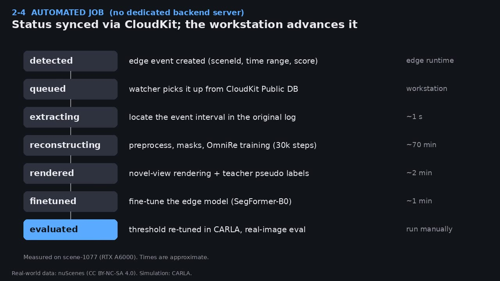
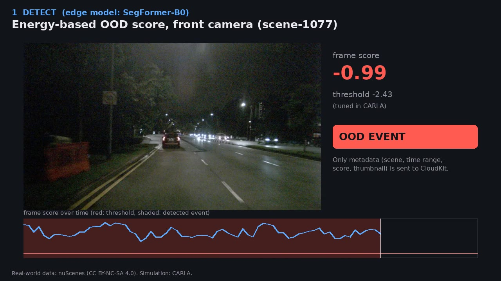
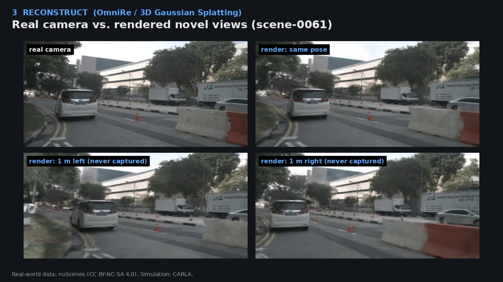
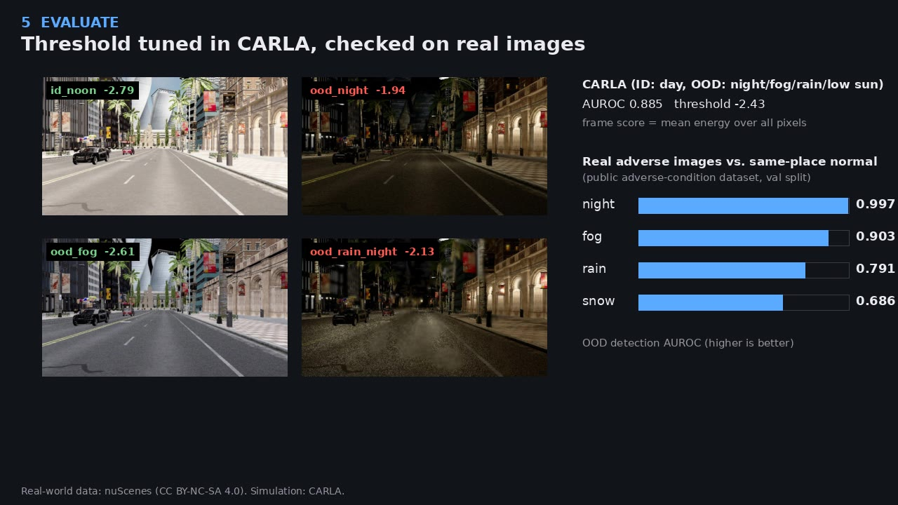

<div align="center">

# ShadowSplat

**An automated data loop for autonomous driving:<br>edge OOD detection → 3D Gaussian Splatting reconstruction → model fine-tuning → evaluation**




<sub>First: the edge model flags a night drive as out-of-distribution. Then: a drive reconstructed in 3D and re-rendered from viewpoints that were never captured.</sub>

</div>

---

## Why

What limits autonomous driving is how efficiently rare corner cases are found and fed back into training.
ShadowSplat reproduces that loop end to end at small scale:

| | Stage | What happens |
|:-:|---|---|
| 🔎 | **Detect** | A lightweight segmentation model at the edge scores every frame with a per-pixel energy score and flags uncertain (OOD) intervals. |
| 📡 | **Sync** | Only the event metadata (scene, time range, score, thumbnail) is synced through CloudKit. No dedicated backend server. |
| 🧊 | **Reconstruct** | The workstation pulls the interval from the original multi-camera + LiDAR log and reconstructs it, including moving objects, with OmniRe (3DGS). |
| 🎥 | **Render** | Novel views are rendered from the reconstruction and pseudo-labelled by a teacher model, ready to be used as training data. |
| 🛠️ | **Fine-tune** *(optional)* | An optional stage fine-tunes the edge model on that data. Whether the rendered data goes into training is left to the user. |
| 📊 | **Evaluate** | OOD thresholds are tuned in CARLA under controlled conditions and checked on real adverse-condition images. |

## Highlights

- **Fully automated job**: a detected event moves `detected → queued → extracting → reconstructing → rendered` (→ `finetuned`, optional) with no manual step; every stage is a resumable CLI.
- **Real-world reconstruction**: dynamic driving scenes from nuScenes reconstructed with OmniRe (test PSNR 23.2 on a daytime scene, 26.5 on a night scene).
- **OOD detection that transfers to real images**: aggregation chosen in CARLA (AUROC 0.885) and confirmed on real adverse-condition images (**night 0.997, fog 0.903** AUROC).
- **Lightweight edge trigger**: ~8 KB per event (metadata + thumbnail); heavy sensor data never leaves the workstation.

## How it works



### Event lifecycle



Only the workstation advances the status, and every transition is validated; invalid transitions are rejected.

<p align="center"></p>

## Results

### 1. Detect — energy-based OOD score at the edge

<p align="center"></p>

The frame score is the mean per-pixel energy `E(x) = -T·logsumexp(logits/T)`. The aggregation was chosen in CARLA, where the conditions can be controlled:

| Frame score | CARLA AUROC | nuScenes day vs. night AUROC |
|---|:-:|:-:|
| mean of top 5% pixels | 0.634 | 0.991 |
| mean of top 25% pixels | 0.773 | 1.000 |
| **mean of all pixels** | **0.885** | **1.000** |

### 2. Reconstruct — real drives in 3D

<p align="center"></p>

| Scene | Condition | PSNR ↑ | SSIM ↑ | LPIPS ↓ | Training |
|---|---|:-:|:-:|:-:|:-:|
| scene-0061 | day | 23.23 | 0.697 | 0.213 | 30k steps, ~1.5 h |
| scene-1077 | night | 26.47 | 0.668 | 0.504 | 30k steps, ~1 h |

<sub>Held-out test views (1 in 10 frames), RTX A6000.</sub>

### Using the rendered views as training data

The pipeline hands you a reconstruction, novel-view renders and teacher pseudo labels for every detected event. Fine-tuning on them is an optional last stage, and **whether to use the renders for training is your call**. To help with that decision, the stage was measured against alternatives under one recipe (same teacher, same steps, 3 seeds; ACDC real labels) — see [`phase4_ablation.md`](docs/experiments/phase4_ablation.md). In that setup, real frames of the detected scene gave the best result, renders at the original camera pose came close, and large lateral offsets (±1–2 m) did not add to it; the dataset, render resolution and offsets are the knobs to revisit.

### 3. Evaluate — from simulation to real images

<p align="center"></p>

OOD detection on real adverse-condition images (ACDC val, adverse vs. the same places under normal conditions):

| Condition | Night | Fog | Rain | Snow |
|---|:-:|:-:|:-:|:-:|
| AUROC | **0.997** | **0.903** | 0.791 | 0.687 |

Details, per-model thresholds and all raw numbers are in [`docs/experiments/`](docs/experiments).

## Design decisions

| Decision | Why | Rejected alternative |
|---|---|---|
| Edge sends metadata only; the workstation reads the original log | bandwidth is the main constraint of a fleet; avoids CloudKit size limits and quotas | upload sensor data through the sync layer |
| No dedicated backend: CloudKit + resident scripts | nothing to operate besides the workstation | a custom server with a database |
| Reconstruct real logs only; use CARLA for thresholds | simulator scenes already exist as 3D assets; real logs are where reconstruction adds data | reconstruct simulator output |
| Fine-tune only the edge model | an end-to-end driving model is out of reach at personal scale; the data-selection idea carries over | retrain a driving policy |
| Each stage in its own conda env, called as a subprocess | drivestudio (torch 2.0), SegFormer-B5 (torch 1.8) and the runner (torch 2.7) conflict | one shared environment |
| Thresholds re-tuned per model version | fine-tuning shifts the energy scale | one fixed threshold |
| Fine-tuning on renders is an optional stage | its benefit depends on the recipe and was measured on one scene only; users can stop at `rendered` and decide | always train on the rendered views |

More in [`docs/design/`](docs/design) and [`docs/scaling.md`](docs/scaling.md).

## Repository layout

```
ShadowSplat/
├── models/            # edge model, OOD score reference implementation, edge runtime
├── workstation/
│   ├── watcher/       # CloudKit event store, watcher, job runner
│   ├── extract/       # locate event intervals in the log
│   ├── recon/         # OmniRe wrapper (drivestudio is never modified)
│   ├── render/        # novel-view rendering
│   ├── finetune/      # pseudo labels and fine-tuning
│   └── eval/          # metrics (CARLA thresholds, real-image evaluation)
├── sim/               # CARLA data collection
├── scripts/           # demo video
├── configs/           # one YAML per phase / experiment
├── tests/             # pytest
├── docs/              # design notes, experiment records, assets
└── third_party/       # drivestudio (git submodule)
```

## Getting started

<details>
<summary><b>Environments</b></summary>

Dependencies conflict between stages, so there are three conda environments; the runner calls each stage as a subprocess.

| Env | Used for | Main dependencies |
|---|---|---|
| `drivestudio` | preprocessing, OmniRe training, rendering | Python 3.9, PyTorch 2.0 + CUDA 11.7 (follow drivestudio's instructions) |
| `segformer` | sky / dynamic masks, pseudo labels (SegFormer-B5) | Python 3.8, PyTorch 1.8, mmseg (official SegFormer code) |
| `shadowsplat-models` | watcher / runner, B0 inference and fine-tuning, evaluation, CARLA client | Python 3.10, PyTorch 2.7 + CUDA 12.6 |

```bash
git clone --recursive https://github.com/IK-Lv7/ShadowSplat.git
cd ShadowSplat
conda create -n shadowsplat-models python=3.10 && conda activate shadowsplat-models
pip install torch==2.7.1 --index-url https://download.pytorch.org/whl/cu126
pip install -r models/requirements.txt
cp .env.example .env    # paths, CloudKit keys, etc. (never commit)
```
On WSL2, also `export LD_LIBRARY_PATH=/usr/lib/wsl/lib:$LD_LIBRARY_PATH`.

Tested on an NVIDIA RTX A6000 (48 GB) under WSL2; OmniRe training uses about 12 GB of VRAM.
</details>

<details>
<summary><b>CloudKit</b></summary>

1. Create an iCloud container in the Apple Developer portal and define the `OODEvent` record type in the CloudKit Console (fields in [`CLAUDE.md`](CLAUDE.md)).
2. Add QUERYABLE indexes on `recordName` and `status`.
3. Create a key pair and register the public key under *Server-to-Server Keys*:
   ```bash
   openssl ecparam -name prime256v1 -genkey -noout -out eckey.pem
   openssl ec -in eckey.pem -pubout
   ```
4. Put the container ID, key ID and private key path in `.env`.
</details>

<details>
<summary><b>Data</b></summary>

No datasets are included. Download them from the official sites and follow their (non-commercial) licenses.

- **nuScenes** v1.0-mini — reconstruction and detection input (`NUSCENES_RAW`)
- **ACDC** val / val_ref — real adverse-condition evaluation (`ACDC_ROOT`)
- **CARLA 0.9.16** — threshold tuning (`CarlaUE4.sh -RenderOffScreen`)
</details>

### Run

```bash
# Edge runtime: replay nuScenes and create OOD events
python -m models.edge_sim
python -m workstation.watcher.watcher --import-edge-sim data/phase1/edge_sim

# Workstation daemon: detected → extract → reconstruct → render → fine-tune
python -m workstation.watcher.runner

# Evaluation
python -m sim.collect                        # collect CARLA images per condition
python -m workstation.eval.carla_threshold   # AUROC and per-model thresholds
python -m workstation.eval.acdc_eval         # real adverse-condition images

# Demo video
python scripts/make_demo.py                  # → data/phase6/demo.mp4

# Tests
pytest tests
```

Every stage can also be run on its own and skips work that is already done.

## Limitations

- **Shadow-mode-style detection**: detection is based on the edge model's own uncertainty, not a comparison with a production driving stack.
- **No real vehicle hardware**: inputs are replayed public logs and a simulator; the edge runtime runs on the workstation.
- **Confidence-based OOD detection**: errors made with high confidence are not caught by an energy score.
- **Reconstruction**: quality drops for large viewpoint changes and for regions never observed (one pass over a place gives limited coverage).
- **Thresholds**: tuned per model version; values tuned in simulation need calibration on deployment-domain data.
- **Scale**: personal-scale validation. See [`docs/scaling.md`](docs/scaling.md) for what changes at fleet scale.

## Documentation

| Phase | Record |
|---|---|
| 0 · OmniRe reconstruction | [`phase0_omnire_nuscenes_mini.md`](docs/experiments/phase0_omnire_nuscenes_mini.md) |
| 1 · Edge runtime and OOD score | [`phase1_edge_sim_nuscenes_mini.md`](docs/experiments/phase1_edge_sim_nuscenes_mini.md) |
| 2 · CloudKit watcher | [`phase2_watcher.md`](docs/design/phase2_watcher.md) |
| 3 · Automated reconstruction | [`phase3_runner.md`](docs/design/phase3_runner.md), [`phase3_scene1077_nan.md`](docs/experiments/phase3_scene1077_nan.md) |
| 4 · Rendering and fine-tuning | [`phase4_scene1077_finetune.md`](docs/experiments/phase4_scene1077_finetune.md) |
| 4 · Ablation (real vs. rendered training data) | [`phase4_ablation.md`](docs/experiments/phase4_ablation.md) |
| 5 · Evaluation | [`phase5_carla_threshold.md`](docs/experiments/phase5_carla_threshold.md), [`phase5_acdc_eval.md`](docs/experiments/phase5_acdc_eval.md) |
| Scaling | [`scaling.md`](docs/scaling.md) |

## References

- OmniRe: Omni Urban Scene Reconstruction (ICLR 2025) — via [drivestudio](https://github.com/ziyc/drivestudio)
- Energy-based Out-of-distribution Detection (NeurIPS 2020)
- SegFormer: Simple and Efficient Design for Semantic Segmentation with Transformers (NeurIPS 2021)
- ACDC: The Adverse Conditions Dataset with Correspondences (ICCV 2021)
- ISO 21448 (SOTIF)

## License and credits

- **Code**: [MIT License](LICENSE).
- **Images in `docs/assets/`**: contain data from [nuScenes](https://www.nuscenes.org/) and are licensed under [CC BY-NC-SA 4.0](https://creativecommons.org/licenses/by-nc-sa/4.0/). They also contain renders from [CARLA](https://carla.org/).
- **Not covered by this license**: the third-party code, model weights and datasets used by the pipeline follow their own licenses — drivestudio (MIT, git submodule), SegFormer weights (NVIDIA Source Code License, non-commercial), nuScenes and ACDC (non-commercial terms of use). None of the weights or datasets are redistributed here.
